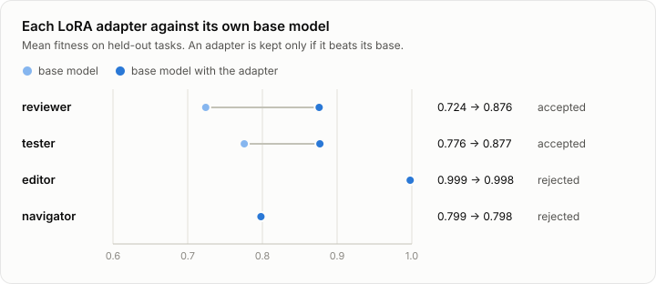
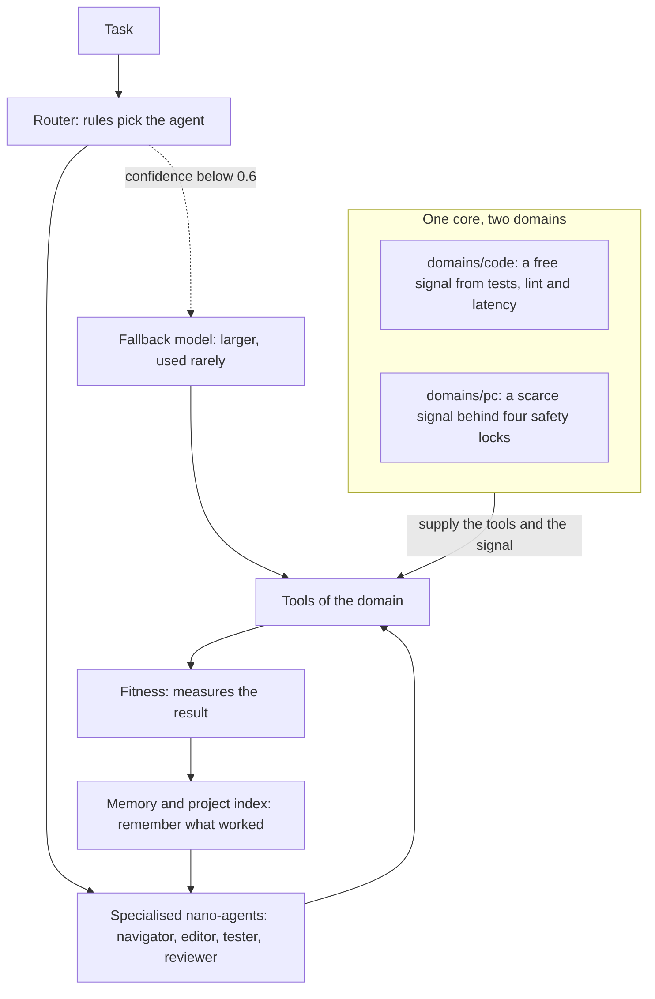

# nano-swarm

A swarm of **nano-agents** on **tiny language models** (0.5B to 4B, quantised) that specialise, adapt to a project and evolve, cheaply from day one.

Instead of one large model that does everything, it uses several small, sharp ones, each an expert at its task and coordinated by a router. The swarm learns the structure of the project it enters and adjusts its behaviour. Later it generates variants of itself and keeps the ones that measure better.

It follows the thesis that most agentic work does not need a frontier model, but a small, fast and well-orchestrated one.

<picture>
  <source media="(prefers-color-scheme: dark)" srcset="docs/ab-dark.svg">
  <source media="(prefers-color-scheme: light)" srcset="docs/ab-light.svg">
  
</picture>

## Architecture



One shared core (`core/`: router, base agent, swarm, memory and fitness) drives two domains. It was built on code first, because there the tests say for free whether a result is right or wrong, which is the signal evolution needs. The same core was then ported to PC automation, behind safety locks. The design rules and the build order are in [`docs/architecture.md`](docs/architecture.md).

| Agent | Model in the final swarm | Job |
| --- | --- | --- |
| navigator | `qwen2.5:1.5b` with evolved directives | Understands the project's structure and finds where to act. |
| editor | `qwen2.5:3b` | Writes and modifies code in specific files. |
| tester | `Qwen2.5-1.5B` with a LoRA adapter | Runs tests and linters and reads their results. |
| reviewer | `Qwen2.5-1.5B` with a LoRA adapter | Reviews changes before they are accepted. |

## Status: the four phases are complete

Each phase was measured and green before the next one started. After the last one, an adversarial review found 14 real bugs (in the locks, the integrity of the fitness, the evolution and the core). All were fixed with regression tests and everything was **measured again** with the clean pipeline. The numbers below are from that second measurement.

| Phase | What it does | Measured result |
| --- | --- | --- |
| **1 · Base** | The swarm on code, adapting through context (RAG and memory), no weights trained | Quality gate green (18 tasks, real Ollama, seed 42) |
| **2 · LoRA** | Each agent specialised on the GPU, accepted only if its fitness improves | **2 of 4 adapters accepted** (tester, reviewer) |
| **3 · Evolution** | Generates and selects variants, all gated by fitness, with lineage | Winners in `evolution/winners/`; a real gain for the navigator |
| **4 · PC** | The same core with the four locks on; low-risk tasks in dry mode | Four locks green; dry, live and rollback demo |

The final swarm reaches a **mean fitness of 0.886** over the 18 tasks (`eval/results/phase_final.json`), with the metric already hardened by the review. `make test` runs **52 tests**.

**Phase 2, the A/B verdicts.** The same Hugging Face base with and without the adapter, the same `core/fitness`, held-out tasks. An adapter is accepted only if it measures better than its own base:

| Agent | Base | With LoRA | Verdict |
| --- | --- | --- | --- |
| reviewer | 0.724 | **0.876** | Accepted |
| tester | 0.776 | **0.877** | Accepted |
| editor | **0.999** | 0.998 | Rejected: the base is already at the ceiling |
| navigator | **0.799** | 0.798 | Rejected |

Two rejections are the quality gate working: an adapter that does not beat its base does not get in. The editor went from accepted to rejected when a bug that penalised its base model was fixed, and the part of the gain that was an artefact of the bug disappeared. Per-task detail is in `eval/results/ab_*.json`.

**Phase 3, evolution.** Variants are gated by `core/fitness`, with an append-only lineage and caps on generations and time. The navigator improves from **0.642 to 0.746** with two prompt directives; the other agents are near the ceiling and their gains are marginal. The lineage is in `evolution/lineage/*.jsonl` and the winners in `evolution/winners/*.json`.

## Stack

- Python 3.11 or newer, [uv](https://docs.astral.sh/uv/) and `make`.
- [Ollama](https://ollama.com/) serving quantised Qwen2.5 models (0.5B, 1.5B, 3B).
- PyTorch, Transformers and PEFT for the LoRA phase, on an NVIDIA GPU.
- pytest.

## Run it

```bash
make install      # creates .venv with uv and installs the core (pyyaml and pytest)
make pull-models  # downloads the tiny models through Ollama
make test         # the core's test suite, 52 tests
make eval         # the quality gate: 18 tasks against Ollama
make run          # starts the swarm on the current directory
```

On Windows `make` uses `.venv/Scripts/python.exe`. On Linux and macOS: `make PY=.venv/bin/python <target>`.

To see the whole system wired together without any model (it checks the plumbing, not the intelligence):

```bash
python -m eval.run --fake
```

The two accepted adapters are not in the repository (72 MB each). Train them again before running the final swarm, or point `tester` and `reviewer` back to the `small` model in `config/swarm.yaml`:

```bash
uv pip install -e ".[phase2]" --python .venv/Scripts/python.exe
uv pip install torch --index-url https://download.pytorch.org/whl/cu128
python -m training.build_datasets              # regenerates the datasets (see DATASET.md)
python -m training.train_lora --agent tester   # capped at 300 steps, 20 minutes, 4 epochs
python -m training.train_lora --agent reviewer
python -m training.ab_eval --agent reviewer    # accepts the adapter only if it beats its base
```

The other phases:

```bash
python -m eval.run --json eval/results/phase1_baseline.json                           # phase 1 baseline
python -m evolution.run --all --generations 3 --population 3 --max-minutes 25         # phase 3
python -m domains.pc.demo                    # phase 4, dry mode: checks the four locks, touches nothing
python -m domains.pc.demo --live --rollback  # applies for real and then undoes it
```

## The four locks of the PC domain

Every real change goes through these, **in order**, and the adapter is in **dry mode** by default: it does not touch the real world until it is given an explicit `live=True`.

1. **Kill switch and rollback.** A `.swarm/KILL` flag aborts any action, and an append-only journal with backups allows everything to be undone (`PCAdapter.rollback()`).
2. **Permissions by capability.** Deny by default: each agent receives only specific `(actions, paths)`, and a single denial aborts the whole plan.
3. **Dry run.** A pure plan, without touching the disk, that validates the jail, the protected paths and the chained state. If one step is invalid, nothing runs.
4. **Sandbox.** The whole plan is rehearsed on a replica of the tree, with its postconditions checked, before it is promoted to the real one.

```bash
echo stop > .swarm/KILL    # emergency stop: the adapter aborts before its next action
python -c "from domains.pc.safety.kill_switch import KillSwitch; KillSwitch('.swarm').rollback()"
```

## Technical decisions

- **The metric comes before the evolution.** Without a fitness function that can be trusted, no variant is generated or selected.
- **Code first.** Tests, lint and latency give the fitness signal for free, so the core was proven there before it was pointed at a PC.
- **An adapter has to beat its own base.** The A/B uses the same base model, the same fitness and held-out tasks, and two of the four adapters were rejected.
- **Training data cannot leak into the evaluation.** The names the evaluation suite uses are on a blacklist, and the dataset builder fails if a training example contains one ([DATASET.md](DATASET.md)).
- **Evolution is bounded.** Variants are gated by fitness, the lineage is append-only, and generations and time are capped.
- **The PC domain is dry by default.** Nothing real happens without four locks and an explicit switch ([SECURITY.md](SECURITY.md)).

## Notes

- The agents' prompts and the command-line output are in Spanish: the adapters were trained with those exact prompts.
- Training data: MBPP (CC-BY-4.0) and synthetic examples; see [DATASET.md](DATASET.md). The base models are Apache-2.0.

## License

[MIT](LICENSE)
